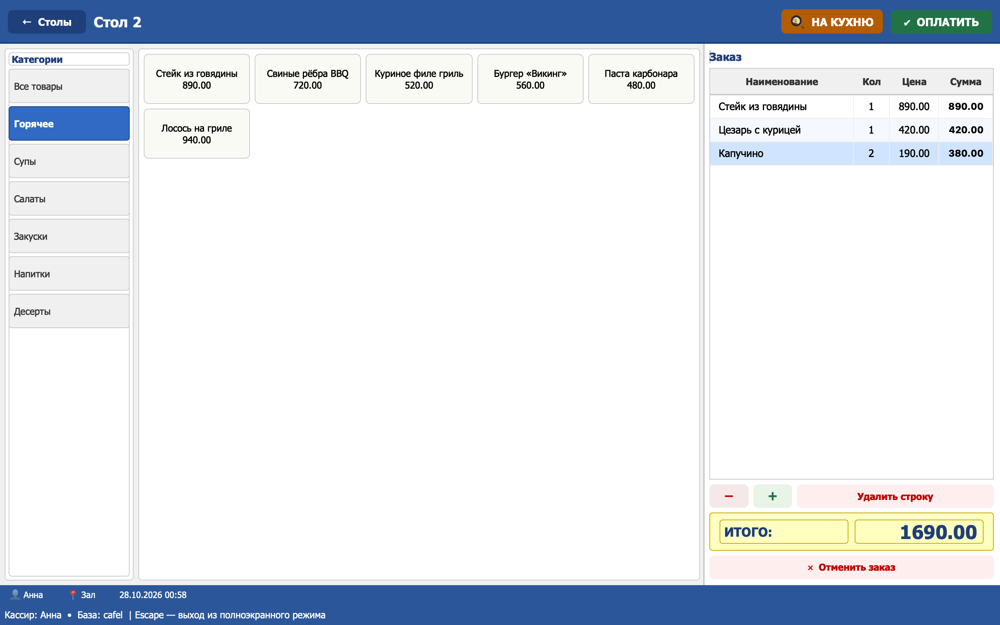
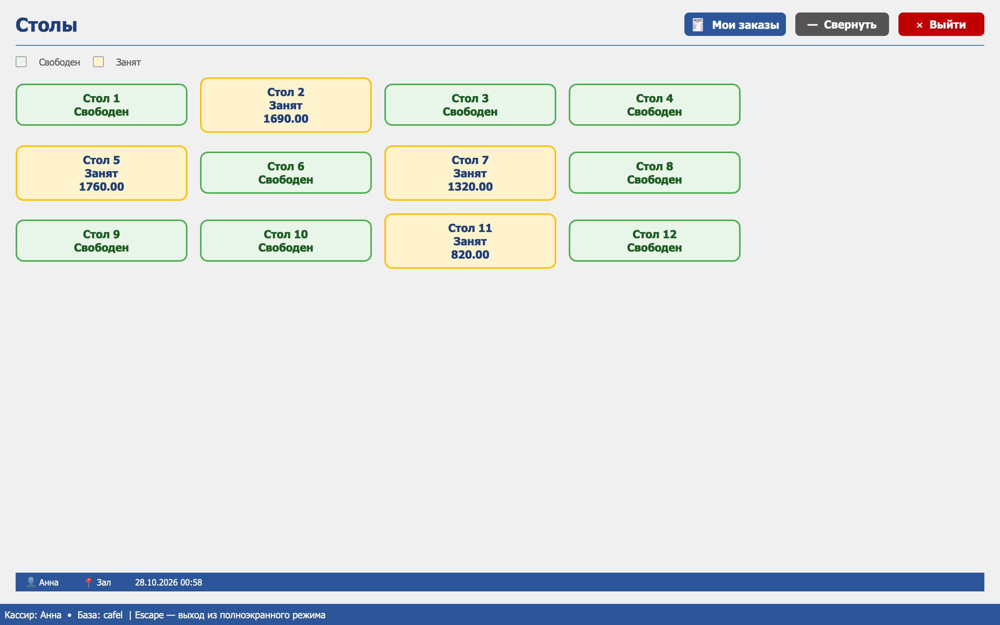
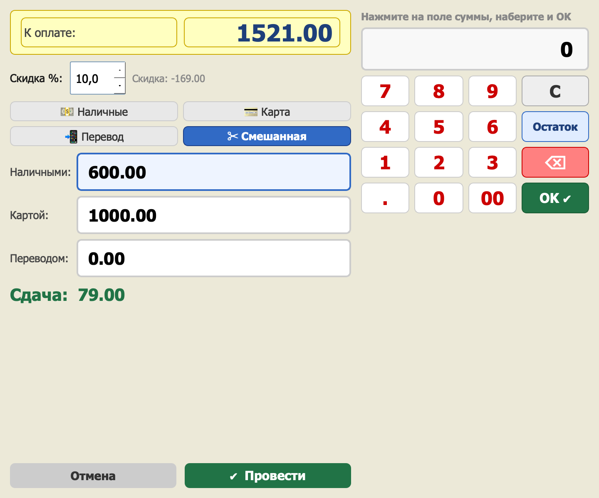
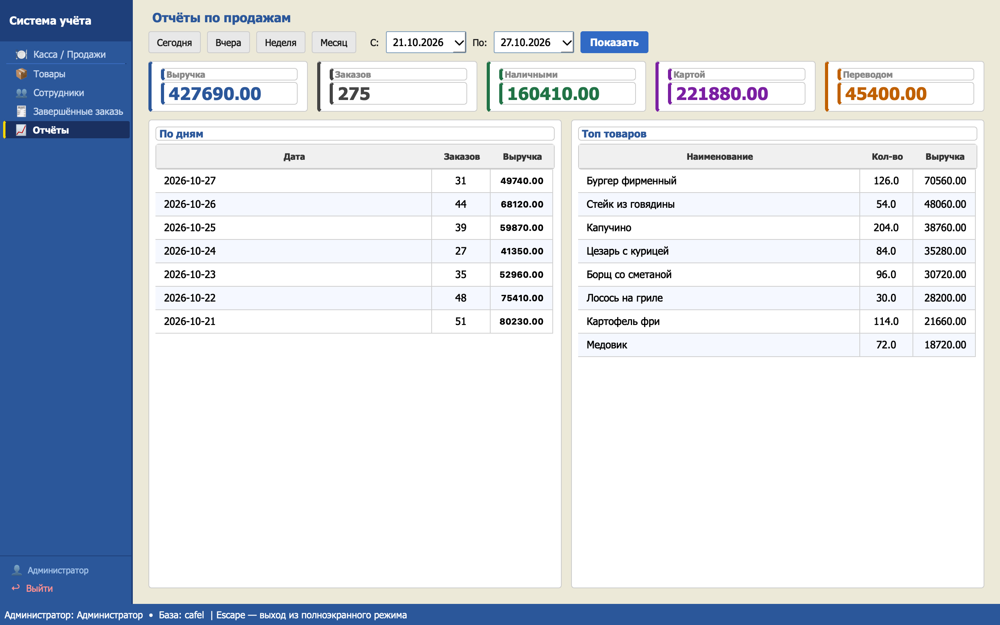
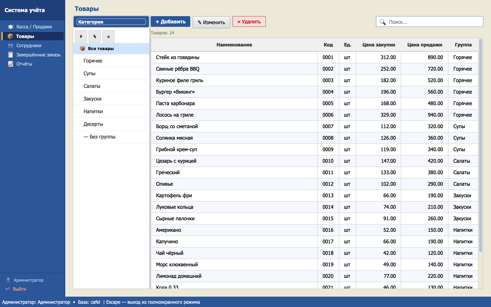
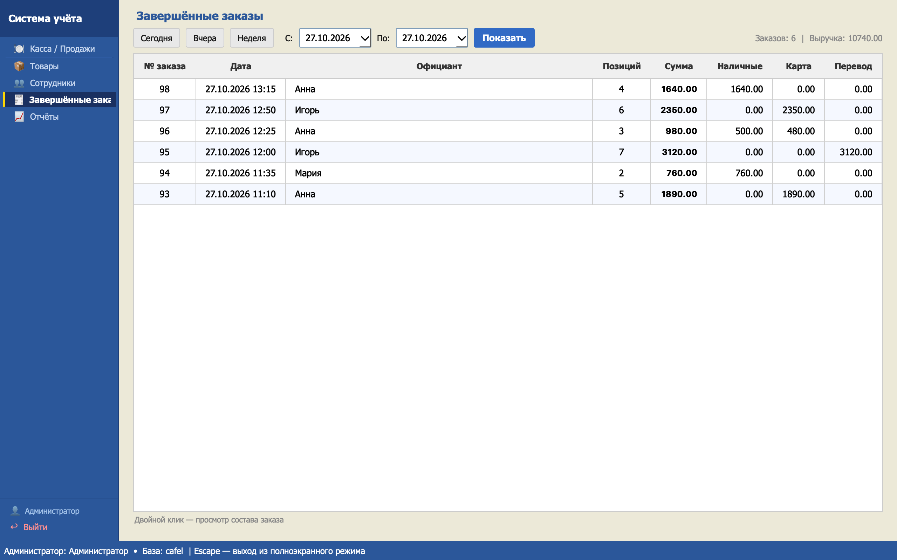
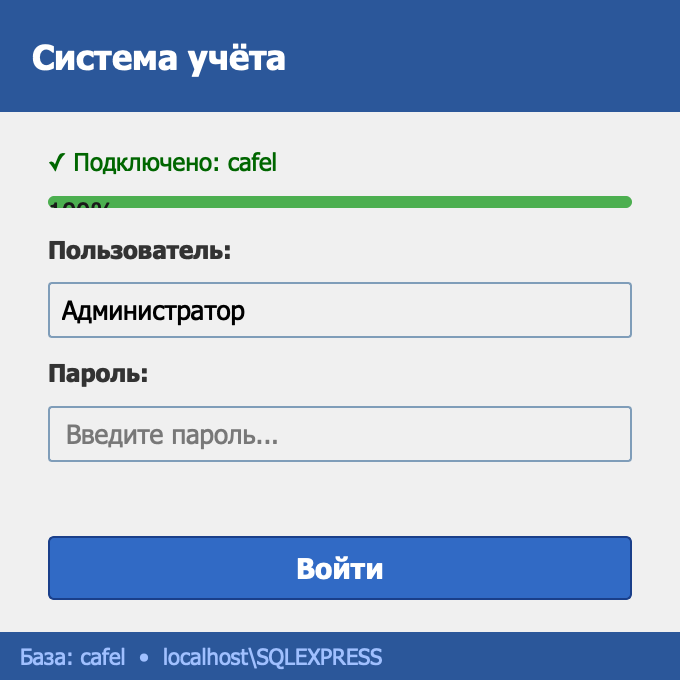

# Касса

Программа для сенсорного POS-терминала кафе: столы, заказы, оплата, чеки,
отчёты. Написана на Python + PyQt6. Работает с базой **Microinvest Warehouse**
на MS SQL Server, поэтому продажи с кассы видны в Microinvest, а товары и
сотрудники берутся оттуда же.

<p align="center">
  
</p>

## Возможности

**Касса (официант, кассир)**
- Экран столов: свободные и занятые столы с суммой заказа.
- Меню по категориям крупными кнопками, корзина с «+», «−» и удалением строки.
- Печать заказа на кухню и чека на термопринтер 58 мм.
- Оплата наличными, картой, переводом или смешанно, скидка в процентах,
  расчёт сдачи на экранном нумпаде.
- «Мои заказы» — завершённые заказы официанта, повторная печать чека.
- Несколько касс на одной базе: стол, открытый на одной кассе, виден на
  другой, а оплаченный заказ больше нельзя изменить.

**Управление (менеджер, администратор)**
- Товары и категории меню: цены, коды, штрихкоды.
- Сотрудники, роли и пароли.
- Завершённые заказы за период с разбивкой по способам оплаты.
- Отчёты: выручка, наличные / карта / перевод, продажи по дням, топ товаров.

**Обслуживание**
- Обновления с GitHub: при запуске касса предлагает «Обновить сейчас / Позже»,
  а при сбое откатывается сама.
- `rollback.bat` — ручной откат на предыдущую версию.
- `db_report.bat` — отчёт о подключённой базе (только чтение).

## Скриншоты

<sub>Демо-данные. Сняты на macOS, поэтому шрифты отличаются от Windows-терминала.</sub>

| Столы | Оплата |
|---|---|
|  |  |
| **Отчёты** | **Товары** |
|  |  |
| **Завершённые заказы** | **Вход** |
|  |  |

## Как устроено

```
launch.vbs ──► updater.py ──► main.py ──► окно входа ──► касса / управление
               (обновления)                │
                                           └──► MS SQL Server (база Microinvest)
```

| Путь | Что там |
|---|---|
| `main.py` | Точка входа кассы |
| `updater.py` | Проверка и установка обновлений, откат, запуск `main.py` |
| `ui/` | Экраны: `pos.py` касса, `goods.py`, `staff.py`, `orders.py`, `reports.py`, `printer.py` печать |
| `db/` | Запросы к SQL Server; `report.py` — отчёт о базе |
| `config.example.ini` | Шаблон настроек точки (`config.ini`) |
| `tools/publish.py` | Выпуск новой версии на GitHub Releases |
| `docs/` | [Описание базы](docs/DATABASE.md), скриншоты |

**База данных** — какие таблицы касса читает и пишет, как хранится заказ и
оплата, полезные SQL-запросы, ограничения: **[docs/DATABASE.md](docs/DATABASE.md)**.

## Установка на терминал

Нужны Windows, Python 3.12 из Microsoft Store (команда `py`), ODBC Driver 17
for SQL Server, доступ пользователя Windows к базе на SQL Server и термопринтер
58 мм (T58/R58).

**Первая установка**
1. Распакуйте архив `viking-pos-X.Y.Z.zip` из
   [последнего релиза](https://github.com/uslulu/viking-pos/releases/latest) в папку кассы.
2. Запустите `install.bat` — он поставит зависимости и создаст `config.ini`.
   В `config.ini` укажите сервер и базу.
3. Ярлык на рабочем столе — на `launch.vbs`.
4. Запустите `db_report.bat`: отчёт покажет, подходит ли база кассе.

**Ручная установка поверх старой версии**
1. Закройте кассу и скопируйте папку кассы целиком (например, в `Касса_старая`).
2. Распакуйте архив в папку кассы с заменой файлов. `config.ini` в архиве нет,
   настройки точки сохранятся.
3. В `config.ini` в секции `[update]` должно быть `enabled = true`.
4. Ярлык — на `launch.vbs`. Проверьте вход, стол, оплату и печать чека.

### config.ini
Лежит рядом с `main.py`, шаблон — `config.example.ini`. Обновлениями не
перезаписывается.
- `[database] server, database` — SQL Server и база (Windows-аутентификация)
- `[cafe] name` — название в чеке
- `[update] enabled, ask, url` — обновления; `ask = false` — ставить без вопроса

## Обновления

При запуске updater до 5 секунд ищет новую версию в
[последнем релизе](https://github.com/uslulu/viking-pos/releases/latest) на GitHub.
Если она есть, кассир видит окно «Доступна новая версия»:
- **Обновить сейчас** — архив скачивается, проверяется sha256, текущие файлы
  копируются в `backup/<версия>`, новые распаковываются поверх.
- **Позже** (или нет ответа 60 секунд) — касса запускается как обычно, вопрос
  повторится при следующем запуске.

Защита от поломки кассы:
- нет интернета или GitHub не отвечает — касса запускается без обновления;
- новая версия падает до показа главного окна — автоматический откат, эта
  версия больше не предлагается;
- выключили питание во время установки — откат при следующем запуске;
- новая версия работает неправильно — закройте кассу и запустите
  `rollback.bat`.

Логи: `update.log` (обновления), `main.log` (вывод кассы).

## Выпуск новой версии

Нужен GitHub CLI (`winget install GitHub.cli`, затем один раз `gh auth login`).
Сначала тестовый выпуск, кассы его не видят:
```
git commit -am "..."
py tools/publish.py --test -n "Что нового"     # 1.1.0 -> 1.1.1
```
Скачайте архив из релиза, поставьте вручную на одну кассу и проверьте. Затем:
```
py tools/publish.py --promote                  # тот же архив — всем кассам
```
`minor` / `major` / `X.Y.Z` задают номер вместо следующего патча:
`py tools/publish.py minor --test -n "..."`. Без `--test` версия сразу
становится последней. В архив обновления не попадают `tools/`, `docs/` и
`config.ini`.
